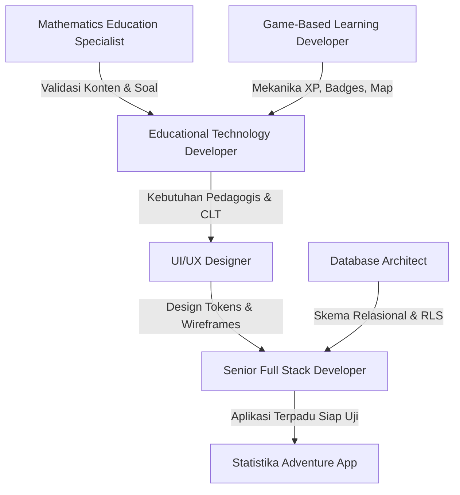

# AGENT OPERATIONAL MATRIX & ROLES (AGENTS.md)
## STATISTIKA ADVENTURE: Pedoman Peran & Spesialisasi Pengembangan

---

### 1. IKHTISAR SISTEM AGEN
Pengembangan aplikasi **STATISTIKA ADVENTURE** melibatkan sinergi dari 6 peran keahlian terintegrasi. Dokumen ini mendefinisikan tanggung jawab, kriteria sukses (*definition of done*), dan batasan kerja bagi masing-masing peran untuk memastikan aplikasi berkualitas tinggi secara pedagogis, teknis, dan visual.

---

### 2. DEFINISI PERAN & TANGGUNG JAWAB

#### 2.1 Mathematics Education Specialist (Spesialis Pendidikan Matematika)
- **Tanggung Jawab:**
  - Menyelaraskan seluruh materi dengan Capaian Pembelajaran (CP) Fase D Kurikulum Merdeka topik Statistika.
  - Memastikan kebenaran matematis definisi, notasi, dan prosedur hitung (data tunggal, tabel frekuensi, mean, median, modus, jangkauan).
  - Menyusun indikator dan butir soal kontekstual yang mengukur 3 proses Literasi Matematis PISA: *Formulating*, *Employing*, *Interpreting*.
  - Menyediakan pembahasan soal (*worked examples*) bertahap dengan bahasa yang ramah bagi siswa SMP usia 13-14 tahun.
- **Kriteria Keberhasilan:**
  - 100% materi dan soal bebas dari miskonsepsi matematis (misal: pengaruh nilai ekstrem pada mean vs median dijelaskan akurat).
  - Soal evaluasi memiliki validitas isi yang kuat untuk pengujian pretest dan posttest.

#### 2.2 Educational Technology Developer (Pengembang Teknologi Pendidikan)
- **Tanggung Jawab:**
  - Menerapkan prinsip *Cognitive Load Theory* (Sweller, 1988; Mayer, 2001) ke dalam struktur alur media.
  - Merancang segmentasi konten (*micro-learning chunking*) agar kapasitas memori kerja (*working memory*) siswa tidak terlampaui.
  - Mengatur prinsip *Signaling* (penandaan konsep esensial) dan *Coherence* (menghilangkan elemen dekoratif nirfaedah).
  - Menghubungkan mekanisme umpan balik instan (*immediate explanatory feedback*) saat siswa menjawab latihan.
- **Kriteria Keberhasilan:**
  - Tidak ada halaman yang menyajikan teks melebihi 150 kata tanpa interaksi atau visual pendukung.
  - Siswa dapat mengontrol laju belajar secara mandiri (*self-paced learning*).

#### 2.3 UI/UX Designer (Desainer Antarmuka & Pengalaman Pengguna)
- **Tanggung Jawab:**
  - Mengembangkan sistem desain visual modern, futuristik, namun ramah anak dengan palet warna biru-ungu cerah (*modern educational gaming aesthetic*).
  - Menerapkan pendekatan *Mobile-First Design* untuk layar smartphone Android (lebar 360px - 412px).
  - Memastikan ukuran target sentuh (*touch target*) minimal 48x48 piksel untuk kenyamanan sentuhan ibu jari.
  - Merancang wireframe dan komponen antarmuka yang bersih, konsisten, dan mematuhi kontras aksesibilitas WCAG 2.1 AA.
- **Kriteria Keberhasilan:**
  - Antarmuka intuitif tanpa panduan manual yang berbelit-belit.
  - Transisi halaman halus tanpa lag grafis pada browser mobile.

#### 2.4 Game-Based Learning Developer (Pengembang Pembelajaran Berbasis Game)
- **Tanggung Jawab:**
  - Merancang loop motivasi intrinsik dan ekstrinsik (Peta Petualangan 8 Level, XP, Level, Badges).
  - Mengonstruksi narasi petualangan bertema penjelajahan dunia data.
  - Mencegah timbulnya *Math Anxiety* dengan meniadakan leaderboard publik yang memicu perbandingan negatif antarsiswa.
  - Mendesain perayaan keberhasilan visual (*visual reward animation*) yang proporsional dan tidak berlebihan.
- **Kriteria Keberhasilan:**
  - Siswa merasa tertantang dan termotivasi menyelesaikan setiap pulau di peta petualangan.
  - Feedback positif dan perolehan badge terasa bermakna (*earned reward*).

#### 2.5 Database Architect (Arsitek Basis Data)
- **Tanggung Jawab:**
  - Merancang skema database relasional ternormalisasi pada PostgreSQL (Supabase).
  - Mengimplementasikan *Row Level Security (RLS)* untuk memastikan data siswa terisolasi secara aman.
  - Membuat indeks efisien untuk pencarian kode siswa, progres level, dan riwayat evaluasi.
  - Menulis skrip migrasi SQL (DDL) dan seed data awal yang realistis untuk pengujian.
- **Kriteria Keberhasilan:**
  - Integritas referensial (foreign keys, check constraints) terjaga kuat.
  - Kueri baca dan tulis berjalan < 50ms tanpa N+1 query problem.

#### 2.6 Senior Full Stack Developer (Pengembang Full Stack Senior)
- **Tanggung Jawab:**
  - Membangun frontend SPA menggunakan React 18, Vite, Tailwind CSS, dan Three.js.
  - Mengembangkan RESTful API menggunakan Python FastAPI dengan arsitektur bersih (*Clean Architecture*).
  - Melakukan optimasi Three.js WebGL rendering untuk perangkat Android: pembersihan memori objek 3D (*dispose geometry & materials*) saat unmount komponen, frame rate locking (60 FPS), dan fallback visual 2D.
  - Menjaga kualitas kode: modular, reusable components, error handling komprehensif, dan dokumentasi API otomatis via OpenAPI/Swagger.
- **Kriteria Keberhasilan:**
  - Kode berjalan tanpa error kompilasi atau runtime exception di browser mobile.
  - Pemisahan bersih antara frontend, backend, dan database.

---

### 3. ALUR KERJA KOLABORASI (WORKFLOW PHASES)
Setiap agen berkontribusi sesuai tahapan 10 Fase pada `TASK.md`:
1. **Fase 1:** Kolaborasi Analisis & Dokumentasi Lengkap (Seluruh Agen).
2. **Fase 2:** Penyusunan Materi & Kisi-kisi Soal (MES + ETD).
3. **Fase 3:** Desain UI/UX & Prototipe (UID + GBL).
4. **Fase 4:** DDL & Supabase Database Setup (DBA).
5. **Fase 5:** Implementasi Frontend React (FSD + UID).
6. **Fase 6:** Implementasi Backend FastAPI (FSD + DBA).
7. **Fase 7:** Integrasi Three.js 2D/3D Lab (FSD + MES).
8. **Fase 8:** Integrasi Penuh API & Database (FSD + DBA).
9. **Fase 9:** Pengujian Responsivitas Mobile & Validasi (Seluruh Agen).
10. **Fase 10:** Deployment & Dokumentasi Final (FSD).
