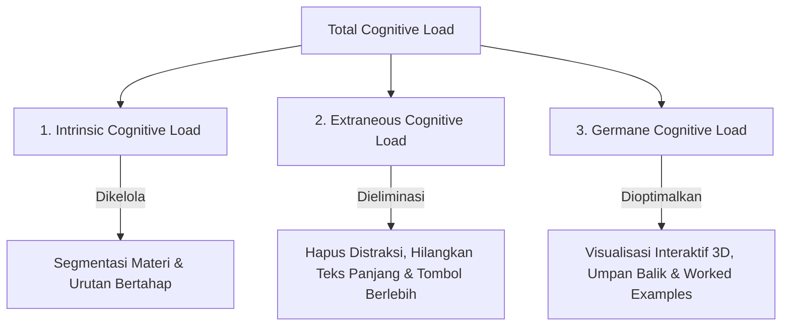

# COGNITIVE LOAD THEORY IMPLEMENTATION (COGNITIVE_LOAD.md)
## STATISTIKA ADVENTURE: Penerapan Cognitive Load Theory dalam Desain Media Pembelajaran

---

### 1. LANDASAN TEORITIS: COGNITIVE LOAD THEORY (CLT)
Cognitive Load Theory (Sweller, 1988; Sweller, van Merriënboer, & Paas, 2019) menyatakan bahwa memori kerja (*working memory*) manusia memiliki kapasitas terbatas dalam memproses informasi baru (sekitar $4 \pm 1$ elemen informasi sekaligus). Dalam pembelajaran matematika dengan media digital, terdapat tiga jenis beban kognitif:

1. **Intrinsic Cognitive Load (ICL):** Beban bawaan dari kompleksitas materi statistika itu sendiri (misal: relasi antar-data dan perhitungan mean/median).
   - *Strategi:* Dikelola dengan memecah materi dari yang paling sederhana (data tunggal) menuju yang lebih kompleks (analisis pencilan).
2. **Extraneous Cognitive Load (ECL):** Beban mental yang timbul akibat desain antarmuka yang buruk, navigasi membingungkan, animasi berlebihan, atau teks bertumpuk.
   - *Strategi:* **DIELIMINASI SECARA TOTAL.**
3. **Germane Cognitive Load (GCL):** Usaha mental siswa yang didedikasikan untuk membangun dan mengintegrasikan skema pengetahuan baru ke dalam memori jangka panjang (*long-term memory*).
   - *Strategi:* **DIOPTIMALKAN** melalui visualisasi interaktif dan worked examples.

---

### 2. ENAM PRINSIP INSTRUKSIONAL YANG DITERAPKAN DI STATISTIKA ADVENTURE

#### 2.1 Prinsip Segmentasi (*Segmenting Principle*)
- **Masalah pada Media Tradisional:** Siswa disajikan teks 1 halaman penuh berisi definisi, rumus, dan 3 grafik sekaligus, menyebabkan kelebihan beban (*cognitive overload*).
- **Implementasi Aplikasi:**
  - Setiap modul materi dipecah menjadi **3 hingga 4 kartu geser kecil (*bite-sized micro-cards*)**.
  - Siswa membaca 1 konsep -> menekan tombol "Lanjut" -> melihat contoh perhitungan bertahap -> mencoba 1 interaksi.
  - Siswa memegang kendali penuh atas laju pemrosesan informasi (*self-paced pacing*).

#### 2.2 Prinsip Koherensi (*Coherence Principle*)
- **Masalah pada Game Edukasi yang Gagal:** Menambahkan terlalu banyak animasi karakter yang melompat-lompat, suara latar musik yang bising, dan efek partikel kilat yang tidak ada hubungannya dengan matematika.
- **Implementasi Aplikasi:**
  - **Eliminasi Dekorasi Nirfaedah:** Seluruh visual yang muncul di layar memiliki tujuan representasi data (diagram, balok 3D, tabel).
  - Audio efek hanya digunakan sebagai umpan balik fungsional (*subtle click sound*, nada sukses lembut saat menjawab benar), dan dilengkapi tombol *Mute/Unmute* yang mudah dijangkau.

#### 2.3 Prinsip Penandaan (*Signaling / Cueing Principle*)
- **Masalah:** Siswa kesulitan menemukan fokus utama dalam rumus atau grafik.
- **Implementasi Aplikasi:**
  - Rumus kunci diberi kotak aksen bercahaya (*glow highlight*) dengan warna Electric Indigo atau Vibrant Cyan.
  - Angka yang sedang dijumlahkan pada worked example disorot secara berurutan dengan warna kontras.
  - Pada grafik 3D, batang atau sektor yang sedang dianalisis terangkat (*elevated/pulsing*) saat dipilih.

#### 2.4 Prinsip Modalitas & Dual Coding (*Modality Principle*)
- **Landasan (Paivio & Mayer):** Informasi visual dan verbal diproses melalui saluran sensorik yang terpisah di otak (saluran visual vs saluran auditori/fonologis).
- **Implementasi Aplikasi:**
  - Menghindari penyajian teks deskriptif panjang di atas diagram grafis.
  - Menyelaraskan teks ringkas di samping visualisasi 3D secara terintegrasi (menghindari *Split-Attention Effect*).

#### 2.5 Prinsip Contoh Bekerja (*Worked Example Effect*)
- **Implementasi Aplikasi:**
  - Sebelum siswa diberikan soal latihan mandiri, aplikasi selalu menyajikan perhitungan tuntas langkah-demi-langkah:
    - *Langkah 1: Identifikasi data.*
    - *Langkah 2: Terapkan rumus.*
    - *Langkah 3: Periksa hasil.*
  - Menghindarkan siswa dari jalan buntu (*frustration impasse*) yang sering memicu kecemasan matematika (*math anxiety*).

#### 2.6 Prinsip Umpan Balik Langsung (*Immediate Explanatory Feedback*)
- **Implementasi Aplikasi:**
  - Saat siswa memilih opsi jawaban pada latihan, sistem tidak hanya menampilkan "Benar" atau "Salah".
  - Sistem menampilkan kartu penjelas dari bawah: menjelaskan **MENGAPA** jawaban tersebut benar dan **DI MANA** letak kekeliruan konsep jika siswa salah memilih.

---

### 3. CHECKLIST AUDIT COGNITIVE LOAD PADA ANTARMUKA

| Kriteria Pemeriksaan | Standar Statistika Adventure | Status |
| :--- | :--- | :---: |
| Jumlah kata per kartu materi | Maksimal 120 kata | ✅ Terpenuhi |
| Jumlah tombol aksi primer di layar | Maksimal 2 tombol utama (Kembali / Lanjut) | ✅ Terpenuhi |
| Durasi animasi transisi | < 300 ms (cepat, tidak menunda proses belajar) | ✅ Terpenuhi |
| Pilihan audio latar belakang | Default hening / efek suara opsional (*toggleable*) | ✅ Terpenuhi |
| Tombol switch 2D / 3D | Tersedia instan jika siswa pusing melihat rotasi 3D | ✅ Terpenuhi |
| Tekanan kompetisi antarsiswa | Papan peringkat publik dihilangkan, diganti progres pribadi | ✅ Terpenuhi |
