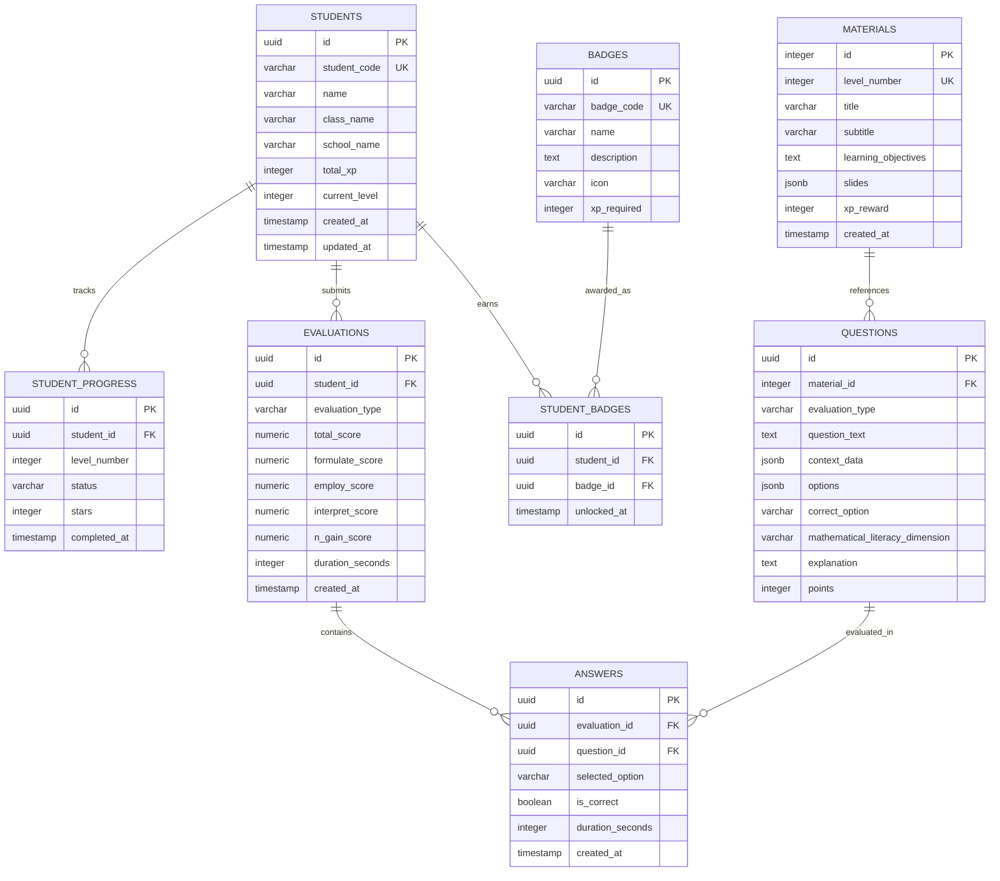

# DATABASE SCHEMA & RLS SPECIFICATION (DATABASE.md)
## STATISTIKA ADVENTURE: Arsitektur Basis Data PostgreSQL (Supabase)

---

### 1. DIAGRAM RELASI ENTITAS (ERD)



---

### 2. STRUKTUR DETAIL TABEL & KONSTRAIN

#### 2.1 Tabel `students`
Menyimpan data identitas siswa yang terdaftar.
- `id` (UUID, Primary Key, `DEFAULT gen_random_uuid()`)
- `student_code` (VARCHAR(20), Unique, Not Null) - Contoh: `SA8A01`
- `name` (VARCHAR(100), Not Null) - Nama Lengkap Siswa
- `class_name` (VARCHAR(20), Not Null) - Kelas, misal: `8A`
- `school_name` (VARCHAR(150), Default: `'SMP Negeri 1 Matematika'`)
- `total_xp` (INTEGER, Default: 0, `CHECK (total_xp >= 0)`)
- `current_level` (INTEGER, Default: 1, `CHECK (current_level BETWEEN 1 AND 8)`)
- `created_at` (TIMESTAMPTZ, Default: `NOW()`)
- `updated_at` (TIMESTAMPTZ, Default: `NOW()`)

#### 2.2 Tabel `materials`
Modul 8 level petualangan statistika dengan data slide JSONB.
- `id` (SERIAL, Primary Key)
- `level_number` (INTEGER, Unique, `CHECK (level_number BETWEEN 1 AND 8)`)
- `title` (VARCHAR(100), Not Null)
- `subtitle` (VARCHAR(150))
- `learning_objectives` (TEXT[], Array string tujuan pembelajaran)
- `slides` (JSONB, Not Null, Menyimpan segmen kartu materi & worked examples)
- `xp_reward` (INTEGER, Default: 50)
- `created_at` (TIMESTAMPTZ, Default: `NOW()`)

#### 2.3 Tabel `questions`
Bank soal latihan, pretest, posttest, dan tantangan literasi matematis.
- `id` (UUID, Primary Key, `DEFAULT gen_random_uuid()`)
- `material_id` (INTEGER, Foreign Key ke `materials.id`, Nullable)
- `evaluation_type` (VARCHAR(30), `CHECK (evaluation_type IN ('pretest', 'posttest', 'practice', 'challenge'))`)
- `question_text` (TEXT, Not Null)
- `context_data` (JSONB, Menyimpan tabel / nilai grafik kontekstual)
- `options` (JSONB, Not Null, Array opsi jawaban `[{"id":"A", "text":"..."}, ...]`)
- `correct_option` (VARCHAR(5), Not Null, misal `'B'`)
- `mathematical_literacy_dimension` (VARCHAR(20), `CHECK (mathematical_literacy_dimension IN ('FORMULATE', 'EMPLOY', 'INTERPRET'))`)
- `explanation` (TEXT, Umpan balik penjelasan solusi)
- `points` (INTEGER, Default: 10)

#### 2.4 Tabel `evaluations`
Menyimpan sesi ujian (pretest / posttest) dan skor analisis literasi siswa.
- `id` (UUID, Primary Key, `DEFAULT gen_random_uuid()`)
- `student_id` (UUID, Foreign Key ke `students.id` ON DELETE CASCADE)
- `evaluation_type` (VARCHAR(30), Not Null)
- `total_score` (NUMERIC(5,2), Default: 0.0)
- `formulate_score` (NUMERIC(5,2), Default: 0.0)
- `employ_score` (NUMERIC(5,2), Default: 0.0)
- `interpret_score` (NUMERIC(5,2), Default: 0.0)
- `n_gain_score` (NUMERIC(4,3), Nullable)
- `duration_seconds` (INTEGER, Default: 0)
- `created_at` (TIMESTAMPTZ, Default: `NOW()`)

#### 2.5 Tabel `answers`
Menyimpan rekaman jawaban per butir soal untuk analisis diagnostik guru.
- `id` (UUID, Primary Key, `DEFAULT gen_random_uuid()`)
- `evaluation_id` (UUID, Foreign Key ke `evaluations.id` ON DELETE CASCADE)
- `question_id` (UUID, Foreign Key ke `questions.id` ON DELETE CASCADE)
- `selected_option` (VARCHAR(5), Not Null)
- `is_correct` (BOOLEAN, Not Null)
- `duration_seconds` (INTEGER, Default: 0)
- `created_at` (TIMESTAMPTZ, Default: `NOW()`)

#### 2.6 Tabel `student_progress`
Status perjalanan level petualangan.
- `id` (UUID, Primary Key, `DEFAULT gen_random_uuid()`)
- `student_id` (UUID, Foreign Key ke `students.id` ON DELETE CASCADE)
- `level_number` (INTEGER, Not Null, `CHECK (level_number BETWEEN 1 AND 8)`)
- `status` (VARCHAR(20), Default: `'LOCKED'`, `CHECK (status IN ('LOCKED', 'IN_PROGRESS', 'COMPLETED'))`)
- `stars` (INTEGER, Default: 0, `CHECK (stars BETWEEN 0 AND 3)`)
- `completed_at` (TIMESTAMPTZ, Nullable)
- `UNIQUE(student_id, level_number)`

#### 2.7 Tabel `badges` & `student_badges`
Gamifikasi lencana pencapaian.
- `badges`: `id` (UUID), `badge_code` (VARCHAR), `name`, `description`, `icon`, `xp_required`.
- `student_badges`: `id` (UUID), `student_id` (UUID), `badge_id` (UUID), `unlocked_at` (TIMESTAMPTZ).

---

### 3. KEAMANAN BASIS DATA & ROW LEVEL SECURITY (RLS)

PostgreSQL RLS memastikan keamanan data pada tingkat baris tabel:
```sql
-- 1. Mengaktifkan RLS pada seluruh tabel
ALTER TABLE students ENABLE ROW LEVEL SECURITY;
ALTER TABLE materials ENABLE ROW LEVEL SECURITY;
ALTER TABLE questions ENABLE ROW LEVEL SECURITY;
ALTER TABLE evaluations ENABLE ROW LEVEL SECURITY;
ALTER TABLE answers ENABLE ROW LEVEL SECURITY;
ALTER TABLE student_progress ENABLE ROW LEVEL SECURITY;
ALTER TABLE badges ENABLE ROW LEVEL SECURITY;
ALTER TABLE student_badges ENABLE ROW LEVEL SECURITY;

-- 2. Kebijakan Baca Publik/Anonim untuk Materi & Badges
CREATE POLICY "Materials are viewable by everyone" ON materials
    FOR SELECT USING (true);

CREATE POLICY "Badges are viewable by everyone" ON badges
    FOR SELECT USING (true);

-- 3. Kebijakan Service Role (Backend FastAPI)
-- Backend menggunakan SUPABASE_SERVICE_ROLE_KEY sehingga memiliki hak akses penuh
-- untuk validasi kode siswa, penulisan evaluasi, dan pembaruan progres.
```

---

### 4. SKRIP DDL LENGKAP & SEED DATA
File SQL terpisah yang siap dieksekusi di Supabase SQL Editor tersedia di:
- `backend/app/db/schema.sql` (Struktur tabel, constraint, trigger waktu, dan RLS)
- `backend/app/db/seed.sql` (Data awal akun siswa demo, 8 level materi, 10 soal pretest/posttest, dan lencana)
