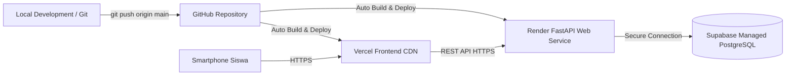

# DEPLOYMENT GUIDE (DEPLOYMENT.md)
## STATISTIKA ADVENTURE: Panduan Penerbitan & Hosting Cloud (Masa Pengembangan 2 Bulan)

---

### 1. RINGKASAN STRATEGI HOSTING CLOUD

Sesuai kebutuhan riset dan masa pengembangan sekitar 2 bulan, aplikasi menggunakan arsitektur cloud terdistribusi dengan tier gratis (*Free Tier*) yang handal:

| Komponen | Platform Cloud Penyedia | Karakteristik Free Tier |
| :--- | :--- | :--- |
| **Frontend SPA** | **Vercel** / **Netlify** | Unlimited bandwidth, global CDN, HTTPS otomatis, deployment via GitHub |
| **Backend REST API** | **Render.com** / **Railway** / **Koyeb** | Gratis untuk web service 24/7, containerized, Python FastAPI support |
| **Database & Auth** | **Supabase Cloud** | PostgreSQL 15, 500MB storage, Row Level Security, koneksi pooled |



---

### 2. KONFIGURASI SUPABASE DATABASE (POSTGRESQL)

1. **Buat Project Baru di Supabase:**
   - Kunjungi [https://supabase.com](https://supabase.com) dan buat proyek baru dengan nama `statistika-adventure`.
   - Pilih region server terdekat: `Singapore (ap-southeast-1)` untuk latensi minimal ke siswa di Indonesia.
2. **Eksekusi DDL & Seed Data:**
   - Buka menu **SQL Editor** pada dashboard Supabase.
   - Salin dan jalankan seluruh isi file `backend/app/db/schema.sql`.
   - Salin dan jalankan seluruh isi file `backend/app/db/seed.sql`.
3. **Catat Kredensial Akses:**
   - Masuk ke **Project Settings -> API**:
     - `Project URL`: misal `https://xyzcompany.supabase.co`
     - `anon public key`: Kunci anonim untuk pembacaan publik.
     - `service_role secret key`: Simpan rahasia, hanya dipasang di backend FastAPI.

---

### 3. PANDUAN DEPLOYMENT BACKEND (FASTAPI DI RENDER / RAILWAY)

#### 3.1 Menggunakan Render.com (Web Service)
1. Buat akun di [https://render.com](https://render.com) dan tautkan akun GitHub.
2. Klik **New +** -> Pilih **Web Service**.
3. Pilih repositori `STATISTIKA ADVENTURE`.
4. Isi parameter konfigurasi:
   - **Name:** `statistika-adventure-api`
   - **Root Directory:** `backend`
   - **Environment:** `Python 3`
   - **Build Command:** `pip install -r requirements.txt`
   - **Start Command:** `uvicorn app.main:app --host 0.0.0.0 --port $PORT`
5. Tambahkan **Environment Variables** pada dashboard Render:
   - `SUPABASE_URL`: URL proyek Supabase Anda.
   - `SUPABASE_KEY`: Kunci `service_role` Supabase.
   - `JWT_SECRET_KEY`: String acak aman (misal: 64 karakter heksadesimal).
   - `CORS_ORIGINS`: URL frontend Anda (misal: `https://statistika-adventure.vercel.app`).
6. Klik **Create Web Service**. URL publik backend akan aktif (contoh: `https://statistika-adventure-api.onrender.com`).

---

### 4. PANDUAN DEPLOYMENT FRONTEND (REACT VITE DI VERCEL)

#### 4.1 Menggunakan Vercel
1. Buat akun di [https://vercel.com](https://vercel.com) dan tautkan GitHub.
2. Klik **Add New...** -> **Project**.
3. Import repositori `STATISTIKA ADVENTURE`.
4. Isi parameter konfigurasi proyek:
   - **Framework Preset:** `Vite`
   - **Root Directory:** klik Edit dan pilih `frontend`
   - **Build Command:** `npm run build`
   - **Output Directory:** `dist`
5. Tambahkan **Environment Variable**:
   - `VITE_API_BASE_URL`: URL Backend FastAPI yang telah dideploy (contoh: `https://statistika-adventure-api.onrender.com/api/v1`).
6. Klik **Deploy**.
7. Konfigurasi Routing Single Page Application:
   - Pastikan terdapat file `vercel.json` di root folder frontend agar rute URL tidak 404 saat direfresh:
   ```json
   {
     "rewrites": [{ "source": "/(.*)", "destination": "/index.html" }]
   }
   ```

---

### 5. CHECKLIST VERIFIKASI PASCA DEPLOYMENT PADA ANDROID

- [ ] Buka tautan Vercel di Google Chrome Android pada smartphone.
- [ ] Uji login menggunakan kode demo: `SA8A01`.
- [ ] Buka Laboratorium 3D: pastikan grafik batang dan lingkaran 3D berputar halus tanpa freeze.
- [ ] Buka Peta Petualangan: verifikasi status level 1 terbuka.
- [ ] Jawab kuis latihan level 1: pastikan poin XP bertambah dan tersimpan di database Supabase.
- [ ] Uji responsivitas dalam orientasi Portrait (tegak) dan Landscape (mendatar).
- [ ] Bagikan tautan web ke guru mitra atau siswa sampel untuk uji coba lapangan.
