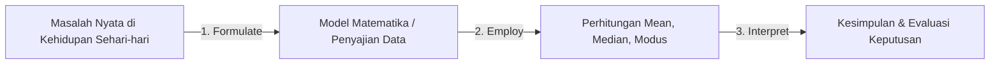

# PEDAGOGICAL LEARNING OBJECTIVES (LEARNING_OBJECTIVES.md)
## STATISTIKA ADVENTURE: Tujuan Pembelajaran & Kerangka Literasi Matematis SMP Kelas VIII

---

### 1. LANDASAN KURIKULUM & CAPAIAN PEMBELAJARAN (FASE D)

Aplikasi **STATISTIKA ADVENTURE** dikembangkan selaras dengan **Kurikulum Merdeka** Mata Pelajaran Matematika Fase D (SMP Kelas VII - IX), khususnya elemen **Analisis Data dan Peluang**.

#### Capaian Pembelajaran (CP) Elemen Analisis Data:
> *"Di akhir fase D, peserta didik dapat merumuskan pertanyaan, mengumpulkan, menyajikan, dan menganalisis data untuk menjawab pertanyaan. Mereka dapat menggunakan diagram batang dan diagram lingkaran untuk menyajikan dan menginterpretasi data. Mereka dapat mengambil sampel yang mewakili suatu populasi untuk mendapatkan data terkait diri dan lingkungan mereka. Mereka dapat menentukan dan menafsirkan rerata (mean), median, modus, dan jangkauan (range) dari data tunggal untuk menyelesaikan masalah kontekstual."*

---

### 2. KERANGKA KERJA LITERASI MATEMATIS (PISA MATHEMATICAL LITERACY FRAMEWORK)

Aplikasi ini secara khusus melatih 3 proses utama literasi matematis menurut OECD PISA:

#### Dimensi 1: Merumuskan Situasi Matematis (*Formulating*)
- Mengidentifikasi aspek matematis dari suatu permasalahan kontekstual di lingkungan sekitar (sekolah, hobi, uang saku).
- Memilih variabel yang tepat, menyusun data mentah menjadi tabel frekuensi, atau memilih jenis grafik yang representatif.

#### Dimensi 2: Menggunakan Konsep, Fakta, & Prosedur Matematika (*Employing*)
- Melakukan operasi aritmetika untuk menghitung nilai Mean.
- Mengurutkan data untuk menentukan letak dan nilai Median.
- Menghitung frekuensi tertinggi untuk menetapkan Modus.
- Menghitung jangkauan (*range*) dan proporsi sudut/persentase diagram lingkaran.

#### Dimensi 3: Menafsirkan, Menerapkan, & Mengevaluasi Hasil (*Interpreting*)
- Membaca makna di balik nilai mean, median, dan modus yang diperoleh.
- Menilai apakah nilai mean terdistorsi oleh adanya pencilan (*outlier* / nilai ekstrem).
- Mengambil keputusan berbasis data (misal: menentukan menu kantin terlaris atau alokasi waktu belajar yang efektif).

---

### 3. TUJUAN PEMBELAJARAN PER LEVEL PETUALANGAN (LEVEL 1 - 8)

| Level | Judul Level | Tujuan Pembelajaran Spesifik | Dimensi Literasi Matematis Dominan |
| :--- | :--- | :--- | :--- |
| **Level 1** | Mengenal Statistika | Siswa dapat membedakan data, populasi, dan sampel serta menentukan sampel representatif dari lingkungan sekolah. | *Formulating* |
| **Level 2** | Pengelompokan Data | Siswa dapat mengorganisasi data mentah ke dalam tabel distribusi frekuensi tunggal dengan teliti. | *Formulating* & *Employing* |
| **Level 3** | Lab Penyajian Data | Siswa dapat menyajikan data dalam bentuk diagram batang, diagram garis, dan diagram lingkaran 2D/3D serta memilih diagram yang tepat. | *Formulating* & *Interpreting* |
| **Level 4** | Menara Mean | Siswa dapat menghitung nilai rata-rata (mean) data tunggal dan menganalisis dampak nilai ekstrem terhadap mean. | *Employing* & *Interpreting* |
| **Level 5** | Jembatan Median | Siswa dapat menentukan nilai tengah (median) untuk kumpulan data berukuran ganjil maupun genap setelah diurutkan. | *Employing* |
| **Level 6** | Lembah Modus | Siswa dapat menentukan modus dari suatu data dan menjelaskan kegunaan modus dalam kehidupan sehari-hari (misal: stok ukuran sepatu/baju). | *Employing* & *Interpreting* |
| **Level 7** | Analisis & Interpretasi | Siswa dapat membandingkan mean, median, dan modus pada suatu kasus serta menentukan ukuran pemusatan mana yang paling representatif. | *Interpreting* |
| **Level 8** | Benteng Literasi | Siswa dapat menyelesaikan masalah kontekstual multi-langkah yang mengintegrasikan penyajian data, pemusatan data, dan pengambilan keputusan logis. | *Formulating*, *Employing*, *Interpreting* |

---

### 4. PENGUKURAN PENINGKATAN KEMAMPUAN (N-GAIN SCORE)
Untuk mengukur efektivitas media pembelajaran terhadap peningkatan literasi matematis siswa, aplikasi mengimplementasikan kalkulasi *Normalized Gain (N-Gain)* dari Hake (1998):

$$g = \frac{S_{\text{post}} - S_{\text{pre}}}{S_{\text{max}} - S_{\text{pre}}} = \frac{S_{\text{post}} - S_{\text{pre}}}{100 - S_{\text{pre}}}$$

#### Kategori Efektivitas Peningkatan:
1. **Tinggi:** $g > 0.70$
2. **Sedang:** $0.30 \le g \le 0.70$
3. **Rendah:** $g < 0.30$
