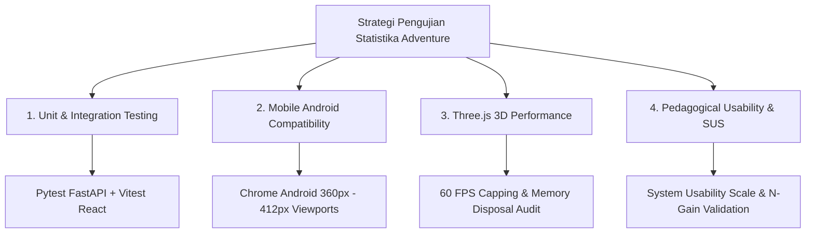

# TESTING STRATEGY & TEST PLANS (TESTING.md)
## STATISTIKA ADVENTURE: Rencana Pengujian Teknis, Mobile, & Pedagogis

---

### 1. STRATEGI PENGUJIAN TERPADU
Pengujian aplikasi **STATISTIKA ADVENTURE** mencakup empat pilar utama:
1. **Fungsionalitas Backend & Database:** Pengujian unit dan integrasi API FastAPI dan Supabase.
2. **Kinerja & Responsivitas Mobile Android:** Pengujian antarmuka pada berbagai resolusi layar smartphone.
3. **Optimasi Grafis Three.js WebGL:** Stabilitas frame rate (60 FPS) dan pencegahan *memory leak*.
4. **Validasi Pedagogis:** Pengujian kelayakan media dan pengukuran *N-Gain* literasi matematis.

---

### 2. PENGUJIAN BACKEND FASTAPI (`backend/tests/`)

#### 2.1 Kasus Uji Unit & Integrasi API

| ID Kasus Uji | Modul | Deskripsi Skenario | Input Data | Ekspektasi Hasil |
| :---: | :--- | :--- | :--- | :--- |
| **TC-BE-01** | Auth | Login dengan kode siswa terdaftar | `{"student_code": "SA8A01"}` | Status `200 OK`, mengembalikan JWT token dan objek siswa |
| **TC-BE-02** | Auth | Login dengan kode siswa tidak terdaftar | `{"student_code": "SALAH99"}` | Status `404 Not Found`, pesan error informatif |
| **TC-BE-03** | Auth | Login dengan format kode kosong | `{"student_code": ""}` | Status `422 Unprocessable Entity` (Pydantic validation) |
| **TC-BE-04** | Materials | Mengambil daftar materi level 1-8 | `GET /api/v1/materials` | Status `200 OK`, array 8 elemen level |
| **TC-BE-05** | Materials | Mengambil detail slide level tertentu | `GET /api/v1/materials/4` | Status `200 OK`, slide materi mean lengkap |
| **TC-BE-06** | Evaluation | Submit jawaban pretest & auto-grading | 10 jawaban pilihan ganda | Status `200 OK`, kalkulasi skor total dan skor 3 dimensi literasi |
| **TC-BE-07** | Evaluation | Kalkulasi N-Gain posttest vs pretest | Skor Pre: 40, Skor Post: 80 | Status `200 OK`, $g = \frac{80-40}{100-40} = 0.667$ (Kategori Sedang) |
| **TC-BE-08** | Progress | Membuka level berikutnya setelah tamat | Level 1 selesai dengan 3 bintang | Status `200 OK`, level 2 berstatus `IN_PROGRESS` |
| **TC-BE-09** | Badges | Klaim lencana baru saat syarat terpenuhi | XP mencapai 500 | Status `200 OK`, badge berhasil dibuka |

---

### 3. PENGUJIAN RESPONSIVITAS MOBILE ANDROID

Pengujian dilakukan menggunakan Chrome DevTools Device Emulation dan perangkat fisik Android:

#### Matriks Perangkat Uji:
1. **Small Screen Android:** 360 x 640 px (contoh: Galaxy A01, Redmi Go)
2. **Standard Modern Android:** 390 x 844 px / 393 x 873 px (contoh: Galaxy A54, Pixel 7)
3. **Large High-Resolution Android:** 412 x 915 px (contoh: Galaxy S23, Xiaomi 13)

#### Kriteria Lolos Uji Mobile:
- Tidak terjadi *horizontal scroll* tak disengaja (*overflow-x: hidden* pada body).
- Ukuran teks terbaca jelas tanpa perlu mencubit layar (*no pinch-to-zoom needed*).
- Jarak antar tombol minimal 12px untuk mencegah salah sentuh (*mis-click prevention*).
- Safe Area Inset untuk smartphone berponi (*camera notch*).

---

### 4. PENGUJIAN KINERJA THREE.JS WEBGL

#### 4.1 Prosedur Uji Beban Memori (*Memory Leak Audit*)
1. Pengguna membuka Laboratorium 3D, memutar grafik batang 3D selama 30 detik.
2. Pengguna berpindah ke menu Peta Petualangan, lalu kembali lagi ke Laboratorium 3D (diulang 10 kali).
3. **Kriteria Kelulusan:** Memori JavaScript heap tidak mengalami peningkatan linear (*memory leak free*). Objek Three.js (`geometry`, `material`, `texture`) didispose dengan benar di `return () => { ... }` pada `useEffect`.

#### 4.2 Prosedur Uji Stabilitas Frame Rate
- Pengujian menggunakan instrumen `stats.js`:
  - Mode 3D Diagram Batang: $\ge 55\text{ FPS}$ konsisten.
  - Mode 3D Diagram Lingkaran: $\ge 58\text{ FPS}$ konsisten.
  - Mode Simulasi Titik Keseimbangan Mean: $\ge 60\text{ FPS}$ konsisten.

---

### 5. PENGUJIAN KEGUNAAN (USABILITY) & LITERASI MATEMATIS

#### 5.1 Kuesioner System Usability Scale (SUS)
Instrumen 10 pertanyaan standar dengan skala Likert 1-5 diujikan kepada sampel siswa SMP:
- Target Skor SUS: $\ge 75$ (Kategori *Acceptable / Good Usability*).

#### 5.2 Pengujian Efektivitas Pembelajaran
- Membandingkan hasil Pretest dan Posttest untuk menghitung rata-rata skor *N-Gain*.
- Target efektivitas: Rata-rata $N\text{-Gain} \ge 0.40$ (Peningkatan kemampuan literasi matematis berada pada kategori minimal 'Sedang').
